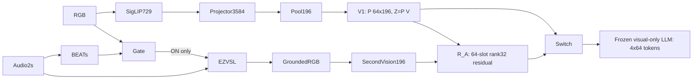

# Current actually loaded model snapshot

|Component|Total params|Historical active (verified where available)|Current trainable|
|---|---:|---:|---:|
|SigLIP|397,747,744|None|0|
|projector|16,980,992|None|0|
|LLM_and_native_special_embeddings|7,612,631,040|not inferred|0|
|Stage1_original|1,991,680|933888|0|
|V1_retrained|1,991,680|933888|0|
|Stage3_original_AudioRouter|1,991,680|None|0|
|R_A|696,320|696320|0|
|BEATs|90,717,055|None|0|
|EZVSL|22,872,064|None|0|
|old_LLP_AVS_proxy|574,059|None|0|
|old_G_A_F0_target|576,097|None|0|
|latest_accuracy_first|576,161|576161|0|
|latest_cost_aware|478,529|478529|0|
|historical_u_only|574,059|573953|0|

Original AudioRouter: audio states [B,96,768] change64queries and routingP[B,64,196]; Z=P@V uses original RGB values. The trained R_A is different: concatenatesRGB/second visual features[392,3584], cosine query-key attention64x392, values3584→32→3584 and residual to frozen V1. Gate OFF is exactly V1, not legacy Extension-disabled Stage3. Latest Accuracy-first uses RGB current/past7168+BEATs1536+context4+frozen r+past counts/2actions; Cost-aware uses RGB7168+cheap acoustic12+context4 and past counts, noBEATs compute. Native8-image reference expands5840visual tokens; compressed4-frame paths256. New IMU stage will use no audio.

Each parameter shape, dtype, device, SHA and loaded requires_grad flag is in JSON/CSV. All loaded modules are frozen. Historical active is not the current trainability. LLM row includes native special embeddings and excludes SigLIP/projector, avoiding double counting. Backbone index and all shard/tokenizer checksums are listed. Actual GPU P/Z/generated-ID legacy regressions passed.
