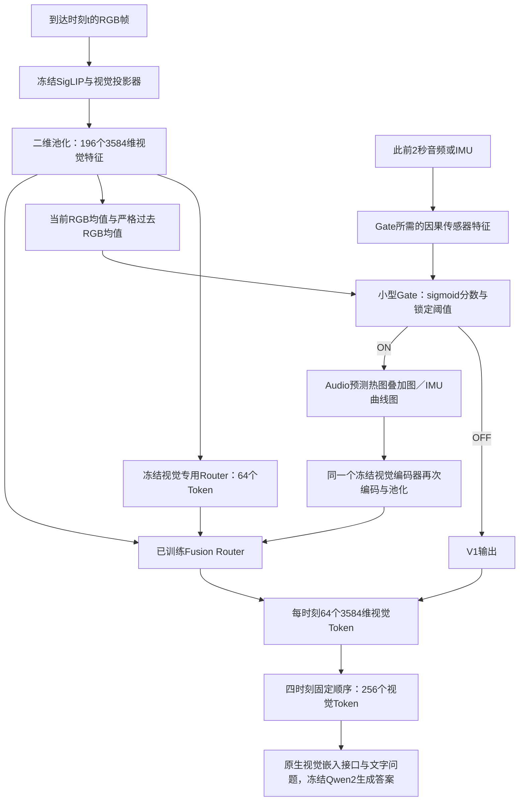

# 当前 Audio 与 IMU 完整架构：重点解释 Gate 和 Router

这里的“当前”指仓库最近完成实验的两套已锁定研究配置：Audio为 **固定已训练融合Router R_A，再匹配训练完整组合Gate**；IMU为 **扩充HoloAssist后分别训练真实／重复／零信号Router，再匹配训练Gate**。它们共用冻结视觉语言模型和V1。不是把历史所有模块串在一起的单一新模型，也没有部署效果承诺。本轮只读取checkpoint与源码，没有运行新推理或训练。

## 总体输入到输出



**Gate回答“是否值得调用辅助分支”，Router回答“如何把视觉证据变成64个Token”。** Gate的输入不是Router的64个Token，而是池化视觉特征的全局摘要与便宜传感器摘要。Router当前不读取问题、标准答案或Gate向量；问题只进入最后的语言模型。音频／IMU数值、Gate分数、传感器类别不作为单独值嵌入进入语言模型。

## 两套系统共同的冻结视觉路径

| 步骤 | 输入 → 输出（单时刻，在线B=1） | 参数／状态 | 解释 |
| --- | --- | --- | --- |
| RGB选择 | 原视频／时钟 → 最近且capture_time≤t的帧 | 无训练 | 音频协议t=2/4/6/8秒；IMU为完成事件8秒片段内相对时刻 |
| SigLIP视觉编码器 | 像素 → [1,729,1152] | 397,747,744，冻结 | 每个原生视觉patch是视觉内容 |
| 视觉投影器 | [1,729,1152] → [1,729,3584] | 16,980,992，冻结 | 映射到语言模型隐藏宽度 |
| 二维空间池化 | 27×27 → 14×14，即[1,196,3584] | 冻结既有算子 | 这里196不是最终LLM Token数 |
| V1视觉路由器 | [1,196,3584] → [1,64,3584] | 对象总1,991,680；历史本阶段活跃933,888；现冻结 | 64查询对196位置加权重采样 |
| 时间拼接 | 4×[64,3584] → 256个视觉Token | 无训练 | 不是把4帧平均成64；也不加入独立传感器Token |
| 语言模型 | 原生文字／视觉嵌入 → 生成文本／选项 | 7,612,631,040（含原生特殊嵌入），冻结 | Qwen2-7b的3584维接口保持；文字Token另计 |

来源：[逐模块运行审计](../../artifacts/imu_visual_next_phase_20261030/M0_snapshot/model_inventory.json)；[visual_frame、answer](../../utility_gate/grounded_dual_image/runtime.py)；[VisionRuntime](../../utility_gate/adaptive_grounded64/runtime.py)。具体选定小模型全部张量的形状、dtype、numel、checkpoint SHA已由本轮CPU读取得到：[完整参数形状CSV](architecture_parameter_shapes.csv)。基础主干参数来自原运行审计，本轮没有重新加载7B主干核数。

## 先理解 V1 与最初 AudioRouter

V1沿用最初AudioConditionedBottleneck的stage=1、phase4、native-value路径。令V∈R^(1×196×3584)：

```
Q0：可学习查询 [1,64,256]                  16,384参数
K = Linear_no_bias(3584→256)(V)           917,504参数
P = softmax(cosine(Q0,K) / 0.05)          [1,64,196]
Z_V1 = P @ V                            [1,64,3584]
```

两组活跃张量共933,888。该类还包含音频生成查询的层，因stage=1不参与这条分支，不能把对象总1,991,680都说成V1训练参数。V1是旧视觉checkpoint在MUSIC656训练QA上继续训练1968步的版本，非从头随机训练。

最初stage=3 AudioRouter则是另一套历史权重。冻结BEATs把2秒音频变成[1,96,768]，先投影768→256；64个基础查询用8头交叉注意力读取完整当前音频Token序列；将时刻t与时间差的6组周期sin/cos合成24维时间特征，经24→256→256投影；每槽拼接基础查询、音频上下文、时间上下文（768维），经768→512→256共享MLP生成query增量。最后同样用cosine/0.05对RGB的196个视觉位置softmax，输出 **P@原RGB视觉值**。没有音频value残差送入LLM，也不是硬Top-K。

stage=2会计算音频查询但仍以静态查询路由，不能把stage=2误认已用音频改变压缩。上述查询生成与分支选择见[AudioQueryGenerator、AudioConditionedBottleneck.forward](../../streamingtom/audio_bottleneck/adbt.py)。当前Audio主实验的Gate ON使用下面的双图R_A，并不再把stage=3音频查询模块串到R_A前面；stage=3只是单独基线。

## 当前 Audio：从原始声音到辅助图

1. 每帧t只裁原始PCM区间[max(0,t−2),t]，先按原始采样时钟同时裁上下界，再转单声道／重采样16kHz，得到32000采样的2秒波形；不足部分因果补零。不能先重采整段再截，否则滤波可能读取未来。
2. 准确率Gate需要BEATs（90,717,055参数、冻结）[1,96,768]；成本Gate只用12维廉价声学统计，不调用BEATs。BEATs是Gate预付成本，即使最后OFF也可能已经计算。
3. Gate ON之后才调用冻结EZ-VSL（22,872,064参数）预测当前RGB中声源区域，使用真实2秒波形并为定位器原生3秒接口左补1秒零。这是输入分布调整，明确记录，不冒称3秒真实因果观察。
4. 预测图取高分20%像素、以alpha=.2的红色叠加到当前RGB。该图仍保留RGB内容，是预测提示，不是GT框或分割图。常数／非法图按render实现退回RGB。当前固定R_A路径只要已决定ON仍执行第二次视觉编码；map回退不自动改变Gate ON计数。
5. 冻结SigLIP→投影→196位置再次编码Grounded Image，再与原RGB特征和V1输出一起送R_A。

来源：[FrozenLocalizer、render](../../utility_gate/grounded_dual_image/grounder.py)；[execute](../../utility_gate/fixed_router_gate/online_inference.py)。Gate与定位不是同一个音频模型：BEATs可为Gate提特征，EZ-VSL负责实际辅助图。成本Gate不需要BEATs，但ON后仍需要EZ-VSL。

## Audio Gate：输入、每层与两个已锁定策略

### 输入不含QA，严格区分当前与过去

当前RGB196位置平均得v_t∈R^3584；严格过去的RGB均值得v_<t∈R^3584（首时刻为零），拼接7168维。BEATs当前Token均值及过去合法音频窗口均值拼接1536维。廉价声学模式每窗口6维：波形RMS、绝对均值、过零率、绝对峰值、log(1+100×RMS)、归一化频谱质心；当前与过去均值拼接12维。过去统计只用已到达的窗口。

4维context为log(1+t)、log(1+Δt)、此前音频可用比例、log(1+观察数)。历史动作特征不是未来动作，是Gate已经执行的ON/OFF：默认2维为历史ON比例与历史ON数/4；history扩展再加最近1、2个开关。准确率Gate还输入冻结共同事件代理标量r，r不是可见声源概率。

源码：[assemble_anchor_features](../../utility_gate/gate2_interfaces.py)；[acoustic_stats](../../utility_gate/fixed_router_gate/features.py)；[history](../../utility_gate/fixed_router_gate/gate_models.py)。

### 网络逐层

| 层 | 准确率优先：history家族 | 成本优先：acoustic家族 |
| --- | --- | --- |
| 视觉支 | 无可训练affine的LayerNorm7168 → Linear7168→64 → GELU | 相同 |
| 传感器支 | LayerNorm1536 → Linear1536→64 → GELU | LayerNorm12 → Linear12→64 → GELU |
| 比较特征 | concat(v64,a64,v−a,v*a,context4)，共260维 | 相同260维 |
| 融合 | Linear260→64 → GELU → Dropout.1 | 相同；推理eval关闭Dropout |
| 决策输入 | 64融合 + 4历史动作 + 1冻结代理r = 69维 | 64融合 + 2历史动作 = 66维 |
| 决策头 | Linear69→32 → GELU → Linear32→1 | Linear66→32 → GELU → Linear32→1 |
| 推理 | sigmoid(logit)>.5且audio有效 | sigmoid(logit)>.25且audio有效 |
| 参数 | 576,161；另有冻结r网络成本 | 478,529；无BEATs／r网络成本 |

音频输入、视觉输入与context在Gate中detach，训练Gate不会反向更新前端。五种候选家族中，audio_r=576097、audio_no_r=576065、visual=465409、acoustic=478529、history=576161；实际参数形状由checkpoint见CSV，结构见[FixedRouterGate](../../utility_gate/fixed_router_gate/gate_models.py)。

### 监督为什么是16组合而不是独立四个标签

固定R_A与V1，四次观察的全部2^4=16个Mask都实际执行完整QA；每来源内对题目NLL平均，得到L(S)。软目标q(S)∝exp(−[L(S)+λ|S|]/T)。网络定义因果轨迹πθ(S)=Π_t Bernoulli(s_t|当前/过去特征,过去开关)，最小化−Σ_S q(S)logπθ(S)。训练离线枚举不同历史路径，不意味着在线Gate会读取未来传感器；各时刻logit只依赖自己的已到达特征和过去动作。

训练192源／656QA，验证96源／335QA；五种家族×λ∈{0,.1,.5,1}×T∈{.25,1}，共40个小Gate，各30轮360更新。准确率策略选history_l0_t0.25第1轮，成本策略选acoustic_l1_t0.25第20轮。验证锁定后不按确认结果调阈值。源码[utility_gate/fixed_router_gate/gate_train.py](../../utility_gate/fixed_router_gate/gate_train.py)、[utility_gate/fixed_router_gate/selection.py](../../utility_gate/fixed_router_gate/selection.py)；锁[artifacts/utility_gate/fixed_router_gate_v1/locks/selection_lock.json](../../artifacts/utility_gate/fixed_router_gate_v1/locks/selection_lock.json)。

## Audio／IMU 共用的 Fusion Router：696,320 参数

这是真正把两张图特征合成固定64个Token的模块。RGB和辅助图各[1,196,3584]，V1基底[1,64,3584]，Gate本身的标量不作为视觉值传入。

| 可训练张量 | PyTorch存储形状 | 参数 | 作用 |
| --- | --- | --- | --- |
| query | [1,64,128] | 8,192 | 64个融合查询，初始化自V1查询前128维 |
| key.weight | [128,3584]，无bias | 458,752 | 两视图视觉特征投影到查询空间；初始化自V1键前128行 |
| value.weight | [32,3584]，无bias | 114,688 | 两视图的视觉值降到rank32 |
| output.weight | [3584,32]，无bias | 114,688 | 把rank32融合残差投回3584维；初始全零 |
| 合计 | 四组张量 | 696,320 | 除此无额外输出归一化或音频残差 |

```
X = concat(V_RGB, V_aux, token_axis)           [1,392,3584]
K = Linear3584→128(X)                         [1,392,128]
P = softmax(normalize(Q) @ normalize(K)^T/.05) [1,64,392]
H = Linear3584→32(X)                          [1,392,32]
ΔZ = Linear32→3584(P @ H)                     [1,64,3584]
Z_ON = Z_V1 + ΔZ                             [1,64,3584]
Z_OFF = Z_V1                                 [1,64,3584]
```

`forward(...,on=False)`直接返回base，完全等于V1；正常在线Pipeline还在更外层OFF时直接绕过Fusion，避免第二图及Fusion调用。output零初始化使初始输出等于V1，但实际训练后四个张量改变。输出来自两种**视觉图像**特征的投影值，仍符合视觉接口；它已不是最初“原RGB原始值的凸组合”，不能再套用原AudioRouter严格native-value凸包结论。P上的高辅助注意力也不是传感器对应真值或QA有效性证明。

唯一实现为[GroundedFusionRouter.forward](../../utility_gate/gate_first_native/fusion.py)。IMU没有新设计另一种大模型，只把Grounded Image替换成IMU曲线图并重新训练相同四张量。Audio Gate-first阶段冻结Gate后训练R_A，Gate未重新标注R_A收益；后来的fixed_router_gate才解决匹配问题。

## 当前 IMU：同步与图像化

HoloAssist同一录制原始相机时钟、加速度时钟、陀螺仪时钟均转到同一参考；.NET ticks先作int64减法，再除10^7变秒，避免大整数浮点精度损失。传感器六通道为头部acc_x/y/z（m/s²）和gyro_x/y/z（rad/s）。两传感器采样不同步时，合并当前窗口内采样时刻，使用因果零阶保持；**用于保持的原始样本本身也必须位于[t−2,t]内**。不做未来双侧插值。无样本／缺失／非法信号触发OFF退回V1。

Gate ON才把2秒曲线画成768×768图：两组加速度／角速度面板，物理单位、固定六轴线色与横轴[-2,0]秒；固定训练集99.5%绝对分位数×1.1坐标上限，不按单窗或确认集重新缩放。不在图中写动作类别、答案、录制ID或问题。零IMU对照保留相同坐标、图例与绘制程序，只把数值设零。DUP是第二张同RGB。WRONG是离线跨源干预，供体按同划分、不同来源／不同类别选定，使用标签安排干预，不能作为部署输入选择机制。

源码[sensor_window](../../utility_gate/imu_visual/scaleup_train/data.py)、[times_from_dotnet_ticks、cheap_stats](../../utility_gate/imu_visual/causal_imu_window.py)、[render_imu_plot](../../utility_gate/imu_visual/render_imu_plot.py)；固定绘图锁[artifacts/utility_gate/imu_visual_scaleup_train_v1/locks/IMU_PLOT_V1.json](../../artifacts/utility_gate/imu_visual_scaleup_train_v1/locks/IMU_PLOT_V1.json)。

## IMU Gate：与Audio复用的地方和唯一输入调整

IMUFeatures类型严格要求visual=[B,7168]、imu=[B,27]、context=[B,4]、valid=[B]bool。视觉与context保持Audio当前／严格过去结构；IMU27维只来自当前因果窗口：六轴均值、标准差、RMS、差分导数RMS各6维，加样本数、有效时间跨度、有效标记。不是27个IMU Token，也不是直接输入曲线图编码。

| 层 | IMU Accuracy／最终Cost别名 |
| --- | --- |
| 视觉投影 | LayerNorm7168（无affine）→ Linear7168→64 → GELU |
| IMU投影 | LayerNorm27（无affine）→ Linear27→64 → GELU；这是Audio acoustic原12维的唯一模态宽度替换 |
| 比较 | concat(v,a,v−a,v*a,context)，260维 |
| 融合 | Linear260→64 → GELU → Dropout.1 |
| 轨迹决策 | 融合64 + 历史动作4 → Linear68→32 → GELU → Linear32→1 |
| 动作 | valid且sigmoid(logit)>.5且未超过cap，则ON；只把已执行ON写入历史 |
| 参数量 | ranking／classification扩展历史479,553；成本候选默认2维历史479,489 |

本IMUGate复用FixedRouterGate('acoustic')主体，替换27维输入并设置是否扩展历史；不读取冻结音频对应代理r，也不需要BEATs或EZ-VSL。准确率与成本最终选**同一ranking_e30_p0.5**、同一SHA、相同阈值，不是两套Gate结构。实现[IMUFeatures、IMUGate、choose](../../utility_gate/imu_gate_router_transfer/gate.py)；在线顺序[one_feature、run](../../utility_gate/imu_visual/scaleup_train/pipeline.py)。

### IMU训练时序

先以RGB+真实图／重复RGB／零曲线分别训练R_REAL、R_DUP、R_ZERO，全部四窗ON、500题×3轮各1500更新，只优化融合四张量，V1与主干冻结。REAL／DUP／ZERO的热启动分别来自旧v3相应训练权重；另有相同零输出初始化的scratch对照。

再冻结新REAL Router，用500训练题与166验证题实际生成全部16mask结果，共10656次完整QA。准确率排序／硬分类目标score=2×incorrect+NLL/(1+NLL)；成本软轨迹score=NLL+λk。四个Gate各30轮1890更新，λ=.05/.2成本候选、温度.25。所有选择只在验证进行，最终锁ranking第30轮阈值.5。训练Gate时Router不更新；55确认题没有参与Utility监督或阈值选择。

路径：[utility_gate/imu_visual/scaleup_train/train_router.py](../../utility_gate/imu_visual/scaleup_train/train_router.py)、[utility_gate/imu_visual/scaleup_train/utility.py](../../utility_gate/imu_visual/scaleup_train/utility.py)、[utility_gate/imu_visual/scaleup_train/train_gate.py](../../utility_gate/imu_visual/scaleup_train/train_gate.py)；[artifacts/utility_gate/imu_visual_scaleup_train_v1/locks/validation_selection.json](../../artifacts/utility_gate/imu_visual_scaleup_train_v1/locks/validation_selection.json)。

## Router之后如何接语言模型

每观察完成就固定保存64×3584视觉嵌入，后续窗口不能重写历史。四组按时间顺序形成4×64×3584，共256视觉Token。由现有视觉插入路径与问题文字嵌入组装，使用正确位置与attention mask调用冻结语言模型；没有先把视觉Token解码成类别再作为答案提示。Audio MUSIC生成短文本，Valor／Holo问题带四个选项，生成单字母，再按标准答案评估。Gold teacher scoring是评估附加步骤，不是在线Gate输入。

模型特殊换行／原生图位置语义按接口保持。压缩路径的实际视觉Token=256；FullVision视频路径4×196+一个video newline=785；原生四张单图4×(729+newline)=2920；原生八图5840。不能把原生接口的729 patch直接当当前Router的输入196位置，也不能把视觉Token数当总文字上下文长度。实现[answer](../../utility_gate/grounded_dual_image/runtime.py)、[prepare](../../utility_gate/grounded_dual_image/native.py)、[fuse_sequence、Runtime](../../utility_gate/imu_visual/scaleup_train/runtime.py)。

## 每次观察真正支付什么计算

| 分支 | RGB编码与V1 | Gate所需前端 | 定位／曲线图 | 第二次视觉编码 | Fusion Router | LLM视觉Token |
| --- | --- | --- | --- | --- | --- | --- |
| 直接Always-off V1 | 是 | 可跳过 | 无 | 无 | 无 | 64 |
| Audio准确率Gate OFF | 是 | 原音频+BEATs+冻结代理+Gate | 无 | 无 | 无 | 64 |
| Audio成本Gate OFF | 是 | 原音频廉价统计+Gate | 无 | 无 | 无 | 64 |
| Audio Gate ON | 是 | 相应Gate前端 | EZ-VSL预测、叠加 | 是 | R_A | 64 |
| IMU Gate OFF | 是 | 因果IMU统计+Gate | 无 | 无 | 无 | 64 |
| IMU Gate ON | 是 | 因果IMU统计+Gate | 曲线绘制 | 是 | R_IMU_REAL | 64 |
| IMU重复RGB训练Always-on | 是 | 无神经Gate，仍做可用性检查 | 无绘图 | 是，付费实现实际调用 | R_IMU_DUP | 64 |
| 原生固定双图 | 绕过压缩Router | 视策略可能仍预付 | 辅助或重复图 | 是 | 完全绕过 | 每时刻1460 |

有cap时只按已用编码数计数，不能回看未来挑最好两窗。固定k2是最早两次观察，不是根据测试答案挑两个。Audio某些早期原生Gate OFF仍第二张RGB，图数不变；不能据Gate ON率推定编码节省。实际调用与延迟应看原付费Pipeline记录，结果和CI见[Audio明细](audio_results.md)与[IMU明细](imu_results.md)。

## 当前checkpoint登记


| 模块／版本 | 实际文件 | 本轮读取SHA256 |
| --- | --- | --- |
| 旧视觉路由器 | [/nvme_data/pkt/streaming/result_main/results/exp01_visiononly64_train_epoch3_lr1e5/adbt_epoch_3.pt](../../results/exp01_visiononly64_train_epoch3_lr1e5/adbt_epoch_3.pt) | 47be825e896292f0efb855e1069e1277d159fd128ce06deaae7bdbe5e811f48a |
| 原始音频条件路由器 | [/nvme_data/pkt/streaming/result_main/results/adbt-phase4.1-q64-tau005-epoch3-lr1e5/adbt_epoch_3.pt](../../results/adbt-phase4.1-q64-tau005-epoch3-lr1e5/adbt_epoch_3.pt) | 1230ce639c8621ffcbb9d3d906179a454a1015475f0ee1b7d3957dc50ce631ec |
| 当前视觉退回分支V1 | [artifacts/utility_gate/adaptive_grounded64_stage1_retrain_20261029_v1/models/stage1_vision64_retrained/selected.pt](../../artifacts/utility_gate/adaptive_grounded64_stage1_retrain_20261029_v1/models/stage1_vision64_retrained/selected.pt) | eb26d508875171cf6e18d6d86eabe34082dec97a72875a90e38e5581ae91b0d4 |
| 当前Audio融合Router R_A | [artifacts/utility_gate/gate_first_router_second_native_ablation_v1/models/fusion_router/selected.pt](../../artifacts/utility_gate/gate_first_router_second_native_ablation_v1/models/fusion_router/selected.pt) | 924ec02aed505f7592e51e3259ae5b8822fbcec1ba5c905205ee5242fd66fe2a |
| 当前Audio准确率Gate | [artifacts/utility_gate/fixed_router_gate_v1/models/history_l0_t0.25/epoch1.pt](../../artifacts/utility_gate/fixed_router_gate_v1/models/history_l0_t0.25/epoch1.pt) | 3ae923809ecf7d0f995043902ecaa971c8b8b0b4af035de7f0763971a192f2fa |
| 当前Audio成本Gate | [artifacts/utility_gate/fixed_router_gate_v1/models/acoustic_l1_t0.25/epoch20.pt](../../artifacts/utility_gate/fixed_router_gate_v1/models/acoustic_l1_t0.25/epoch20.pt) | f5de889e1ad2655b554339f0f6054037743fe6896850699b54fdbf3d9337bd9c |
| 当前IMU真实融合Router | [artifacts/utility_gate/imu_visual_scaleup_train_v1/checkpoints/R_REAL/selected.pt](../../artifacts/utility_gate/imu_visual_scaleup_train_v1/checkpoints/R_REAL/selected.pt) | 5c82a1118078b0bfa34459dcb99c160a4294902ae7b88371f8d22e0426c3052e |
| 当前IMU重复图融合Router | [artifacts/utility_gate/imu_visual_scaleup_train_v1/checkpoints/R_DUP/selected.pt](../../artifacts/utility_gate/imu_visual_scaleup_train_v1/checkpoints/R_DUP/selected.pt) | 26a003ee9c8400905c1f2d48323a30ff2f528a2042a1e555b7afbd7d013f5638 |
| 当前IMU零信号融合Router | [artifacts/utility_gate/imu_visual_scaleup_train_v1/checkpoints/R_ZERO/selected.pt](../../artifacts/utility_gate/imu_visual_scaleup_train_v1/checkpoints/R_ZERO/selected.pt) | 0bef8b2e32646e17ab689b64efdaa7b5590f7000a4ee44dfa2daaaa198129c7d |
| 当前IMU准确率Gate | [artifacts/utility_gate/imu_visual_scaleup_train_v1/checkpoints/G_IMU_accuracy/selected.pt](../../artifacts/utility_gate/imu_visual_scaleup_train_v1/checkpoints/G_IMU_accuracy/selected.pt) | 44d9471168443338623532a9ebc486f27d494b75666700de75defb6f868c7cde |
| 当前IMU成本Gate（同权重别名） | [artifacts/utility_gate/imu_visual_scaleup_train_v1/checkpoints/G_IMU_cost/selected.pt](../../artifacts/utility_gate/imu_visual_scaleup_train_v1/checkpoints/G_IMU_cost/selected.pt) | 44d9471168443338623532a9ebc486f27d494b75666700de75defb6f868c7cde |


上述所有权重本轮仅在CPU读取；审计前后SHA比对见[自动核验](verification_report.json)。它们不是生产部署清单。原模型通路、固定混合F0、训练R_A、IMU同构Router是不同历史版本；有关收益结论以独立队列表为准。
